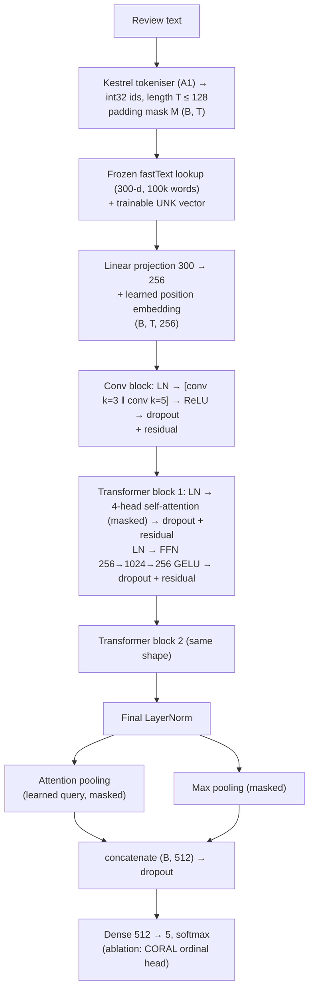

# Kestrel 1.0 Technical Specification

*Written 2026-10-12. Amended 2026-10-16 ([A1](#amendment-1-input-stage-for-short-text)). Status: proposed. No Kestrel code exists yet.*

Kestrel is the mid-weight class of the family: about **1.97M trainable parameters**, four
times Wren 1.0's 481k. It keeps Wren's rule that everything is written by hand in NumPy
and checked by finite differences. It adds what Wren structurally can't do: let every word
see the whole review. This document specifies the full architecture, the training procedure,
the data, the infrastructure and the release gate. It explains every decision and links
reading for each concept. It contains no implementation code: the maths is specified exactly
and the code is yours to write.

Read the [Wren 1.5 upgrade guide](../wren-1.5/wren-1.5-upgrade-guide.md) first. Kestrel reuses its data
pipeline (U2), its fast data path (U6), its evaluation (U1) and AdamW (U4), and those are not
re-explained here.

Kestrel 1.0 is a **review** model. Making it work on general text is the job of
[Kestrel 1.5](kestrel-1.5-spec.md). Kestrel 1.0's only part in that is to *measure* how well it
already transfers (section 11.2), so 1.5 starts from a baseline.

---

## Amendment 1: input stage for short text

*2026-10-16.* Kestrel's intended use now includes sentiment of single news sentences, up to
about 100 words. Kestrel 1.5 keeps 1.0's trunk unchanged ([1.5 spec, section 1](kestrel-1.5-spec.md#1-goal-and-what-changes)),
so any input-stage change has to be made here or not at all. A1 makes three changes. Each is
written into the sections listed and marked **(A1)** there. Everything after the input stage
(conv block, transformer blocks, pooling, head, training procedure, release gate) is unchanged,
apart from numbers that follow from these three changes.

| Change | Was | Now | Sections |
| --- | --- | --- | --- |
| Maximum length | `T_max = 200` | `T_max = 128`. Training reviews over 128 tokens are dropped. | 2, 3.1, 3.4, 8, 10 |
| Vocabulary | The 37,498 words of the training corpus that have a fastText vector | The 100,000 most frequent fastText entries the tokeniser can produce, plus any corpus word with a vector outside them | 3.2, 9.3, 11.2 |
| Punctuation | Deleted, gluing words together | Possessive `'s` removed, other apostrophes deleted, every other punctuation mark becomes a space | 3.1 |

**Kept on purpose:** the 300-d frozen `wiki-news-300d-1M` vectors, the trainable UNK vector and
the 15-word training minimum. Short inputs are 1.5's job (titles and crops, 1.5 spec 3.2–3.3), and
changing the minimum here would change the training data in a second way at once.

**Measured before amending** (first 400k records of `Software.jsonl.gz`, Wren 1.5 cleaning, 15–200 words):

- 3.6% of reviews are over 128 tokens: 5.2% of 1★ and of 2★, 4.5% of 3★, 3.7% of 4★, 2.5% of 5★.
- The new punctuation rule adds 0.6% to the average token count.
- `wiki-news-300d-1M.vec` has 214,504 entries the tokeniser can produce (lowercase ASCII letters
  only). The 100,000th of them is at rank 343,112 of the file.

**What follows from it:**

- The model has 18,432 fewer trainable parameters (1,955,889), because the position table is shorter.
- The training target drops to about 132,000 per class.
- The embeddings file grows from about 45 MB to about 120 MB.
- Kestrel no longer shares Wren 1.5's tokens. Design goal 4 now means the same test *reviews*
  and the same metrics. Both models are still scored on identical reviews, so McNemar's test
  (11.3) still applies. A Kestrel-vs-Wren difference now has two causes, the architecture and
  the input stage. Milestone 3 (section 12) separates them if needed.

---

## Contents

- [Amendment 1: input stage for short text](#amendment-1-input-stage-for-short-text)
1. [Purpose, constraints and design goals](#1-purpose-constraints-and-design-goals)
2. [Specification at a glance](#2-specification-at-a-glance)
3. [Input stage](#3-input-stage)
4. [Convolutional front end](#4-convolutional-front-end)
5. [Transformer encoder blocks](#5-transformer-encoder-blocks)
6. [Pooling and output head](#6-pooling-and-output-head)
7. [Training procedure](#7-training-procedure)
8. [Data](#8-data)
9. [Software infrastructure](#9-software-infrastructure)
10. [Compute and memory budget](#10-compute-and-memory-budget)
11. [Evaluation and release gate](#11-evaluation-and-release-gate)
12. [Build order, ablations and risks](#12-build-order-ablations-and-risks)
13. [Reading list](#13-reading-list)

---

## 1. Purpose, constraints and design goals

### Why a new class rather than Wren 2.0

Wren's errors are concentrated in the middle ratings: recall is 26% for 2★ and 34% for 3★.
Those reviews mix praise and complaint, and their meaning depends on how the clauses relate
to each other ("the setup was painful **but** once running it's flawless"). Wren can't
represent that relationship:

- Each filter sees at most **5 consecutive words**.
- Global max-pooling then **throws away position**. Wren knows *that* "painful" and
  "flawless" both appeared, but not which came after the "but".
- Negation further than 5 words from its target ("I **didn't** think, after all the
  reviews I'd read, that it would be **good**") is invisible to it.

Adding filters or window sizes doesn't change this. It needs a layer where every word's
representation is updated using **every other word** in the review. That's a different
architecture, so it gets a new name and a new parameter class instead of a Wren version
number.

### Constraints carried over from Wren

| Constraint | Consequence for the design |
| --- | --- |
| NumPy only: no autograd, no deep learning framework | Every layer needs a hand-derived backward pass, so each layer type must be simple enough to derive and check. This rules out exotic layers. |
| CPU training | The design must be mostly large matrix multiplies (what BLAS is fast at) and avoid Python loops over time steps. |
| Gradient-checked | Every layer type gets a finite-difference test before it trains anything. |
| `Analyser` API | `Analyser(model="kestrel-1.0").predict(...)` must work exactly like Wren's. |

### Design goals, in priority order

1. **Context across the whole review**: negation and contrast over any distance.
2. **More than 1M parameters that do real work.** Training the 30M embedding numbers would pass that count without adding the context Kestrel is for (see 3.2).
3. **Trainable from scratch on CPU in under a day.**
4. **Directly comparable with Wren**: same test reviews, same metrics. (A1: Kestrel has its own tokeniser and vocabulary, 3.1–3.2.)

**Not a goal: general-domain sentiment.** Kestrel 1.0 is trained and gated on Software
reviews only. Why: generalising needs new data, a new output head and a new release gate
(see the [Kestrel 1.5 spec](kestrel-1.5-spec.md)). Doing that in the same release as a new
architecture would leave two suspects for every result. What 1.0 *does* do is measure transfer
to non-review text without gating on it (11.2). That turns the 1.5 work from guesswork into
"fix these measured failures".

### Name and weight class

| Class | Bird | Trainable parameters |
| --- | --- | --- |
| light | Wren | under 1M |
| **mid** | **Kestrel** | **1M to 10M** |
| (heavy, future) | e.g. Heron or Osprey | over 10M |

A kestrel is a small falcon: clearly bigger than a wren, nowhere near a large raptor.

---

## 2. Specification at a glance

### Fixed hyperparameters

| Name | Symbol | Value | Why this value |
| --- | --- | --- | --- |
| Max review length | `T_max` | 128 tokens (A1) | Covers the inputs of up to about 100 words that Kestrel is aimed at, with room for the extra tokens the punctuation rule adds (3.1). It's a multiple of 8, which matches bucketing's rounding (8). Training reviews over 128 tokens are dropped, not truncated (8), so no training review loses its ending. |
| Embedding input size | `D_e` | 300 (fastText, frozen) | Fixed by the fastText vectors Wren already uses and ships. Changing it means changing the vectors (3.2). |
| Model width | `d` | 256 | The smallest power-of-two width that puts two blocks above 1M parameters. It splits evenly into 4 heads of 64. Every `d²` cost stays CPU-sized (3.3, 5.4, 10). |
| Attention heads | `h` | 4 | Enough heads for several distinct jobs (negation, contrast, emphasis) without making each head too narrow (5.2) |
| Head width | `d_h = d / h` | 64 | The width used by the original transformer and BERT. Narrower heads give noisier dot-product scores. |
| Feed-forward width | `d_ff` | 1024 (4d) | The 4× ratio from the original transformer, used unchanged by BERT and GPT. It gives the FFN, the only per-token nonlinear step, the same share of each block as attention (5.3). |
| Transformer blocks | `N` | 2 | One block attends once. A second can attend to context-aware features ("not" already merged into "good"). A third is an ablation, not the default, because it adds 50% compute (5.4). |
| Conv branches | | k=3 and k=5, 128 channels each | Two branches of 128 sum to exactly `d`, so the residual add needs no extra projection. 3 and 5 span Wren's range (4). |
| Classes | | 5 | The task: 1–5 stars, matching Wren and the dataset |

### Parameter count (exact)

| Component | Parameters | Count |
| --- | --- | --- |
| UNK vector | `u ∈ ℝ³⁰⁰` | 300 |
| Projection | `W_p (300×256) + b_p (256)` | 77,056 |
| Position embeddings | `P (128×256)` (A1) | 32,768 |
| **Input stage** | | **110,124** |
| Conv LayerNorm | `γ, β (256 each)` | 512 |
| Conv k=3 | `(128×3×256) + 128` | 98,432 |
| Conv k=5 | `(128×5×256) + 128` | 163,968 |
| **Conv block** | | **262,912** |
| LN1 | `γ, β` | 512 |
| Q, K, V, O projections | `4 × (256×256 + 256)` | 263,168 |
| LN2 | `γ, β` | 512 |
| FFN in | `256×1024 + 1024` | 263,168 |
| FFN out | `1024×256 + 256` | 262,400 |
| **One transformer block** | | **789,760** |
| **Two blocks** | | **1,579,520** |
| Final LayerNorm | `γ, β` | 512 |
| Attention-pool query | `q ∈ ℝ²⁵⁶` | 256 |
| Output | `512×5 + 5` | 2,565 |
| **Total trainable** | | **1,955,889** |
| Frozen fastText table | about 100k × 300 (A1) | (not counted) |

80% of the parameters are in the two transformer blocks: that's where the new capability is.

**Fallback size, "Kestrel-S":** if the compute budget (section 10) proves too tight, cut
`d_ff` to 512. Each block becomes 527,104 parameters and the total about 1.43M, still above 1M.

---

## 3. Input stage

### 3.1 Tokenisation (A1)

**Decision:** Kestrel has its own cleaner. It is Wren 1.5's (upgrade guide U2) with the
punctuation handling changed. In order:

1. Lowercase, and map curly quotes and dashes to ASCII (as Wren 1.5).
2. Remove a possessive `'s` at the end of a word: `company's` → `company`, `Britain's` → `britain`.
3. Delete every remaining apostrophe: `don't` → `dont`, `didn't` → `didnt`.
4. Replace every other ASCII punctuation character with a space: `long-term` → `long term`,
   `U.S.` → `u s`, `profit/loss` → `profit loss`.
5. Delete digits (as Wren 1.5).
6. Split on whitespace, which also collapses runs of spaces.

Ids come from Kestrel's own vocabulary (3.2), with Wren's reserved `PAD = 0` and `UNK = 1`, in
U6's integer format. Truncate at 128 tokens.

**Why each rule:**

- **A space instead of deletion:** Wren deletes punctuation, which glues words together. `cost-cutting`
  becomes `costcutting` (rank 825,972 in the `.vec`, outside any vocabulary Kestrel loads),
  `far-right` becomes `farright` (not in the `.vec` at all), and `U.S.` becomes `us`, which
  collides with the pronoun. Hyphenated compounds and abbreviations are far more common in news
  than in reviews. Split up, each part is a common word with a well-trained vector.
- **Apostrophes are the exception:** the `.vec` has no `don't`, `can't`, `didn't` or `n't`, but it
  has `dont` (rank 6,941), `cant`, `didnt`, `doesnt`, `isnt` and `wont`. Splitting at the apostrophe
  would give `don t`, putting the negation in a stray `t` whose vector means nothing. Deleting
  the apostrophe keeps Wren's behaviour, which already works and keeps the negation in one token.
- **Possessive `'s` removed:** deleting only the apostrophe gives `companys` (rank 91,790, a rare
  misspelling with a poor vector) and `britains` (rank 249,327). A possessive carries no sentiment,
  and the bare noun has a far better vector (`company` is rank 273). As a side effect, `it's`, `he's`
  and `let's` lose their `s`, which carries no sentiment either.
- **Digits still deleted:** in news, sentiment comes from direction words ("fell", "surged"), not
  from the number. Keeping numbers would need a placeholder token and a second trainable vector.
  That's a change to measure in 1.5, not assume here.
- **Kestrel's own cleaner rather than a change to Wren 1.5's:** Wren 1.5's embedding table and
  trained weights are tied to its tokens. Changing its cleaner would change a released model's
  inputs (the same principle as 9.1).

**Check:** every example in this section, as an input and its expected tokens, is a unit test.
It runs before corpus building, because a tokeniser bug would silently change every split.

**Rejected: training a subword tokeniser (BPE) with embeddings learned from scratch.** That
would fix the 1.35% of unknown words, but embeddings learned from scratch need far more
text than 750k reviews to beat fastText vectors trained on 16 billion tokens.

**Changed from Wren:** padding is no longer a 0.001 row. It is handled by an explicit **mask**
(3.5), because self-attention, unlike max-pooling, would mix padding into every word.

### 3.2 Embeddings: frozen fastText plus a trainable UNK vector

$$
e_t =
\begin{cases}
E_{\text{fastText}}[\text{word}_t] & \text{known word (frozen)} \\
u & \text{unknown word (trainable, } u \in \mathbb{R}^{300}) \\
0 & \text{padding (masked anyway)}
\end{cases}
$$

**Vocabulary (A1).** The table holds the **100,000 most frequent entries of
`wiki-news-300d-1M.vec` that the tokeniser can produce** (lowercase ASCII letters only; the file is
sorted by frequency). It also holds any word in the training corpus that has a vector but falls
outside those 100,000. That's about 30M frozen numbers, roughly 120 MB as float32.

- **Why not only the corpus words (Wren's rule, 37,498 words):** the vectors are frozen, so a word
  doesn't have to appear in training to be useful. An unseen word's vector sits near words the
  model did see ("slump" near "drop"), so the layers above read it the way they read its
  neighbours. Limiting the table to Software-review words throws that away. News is full of
  words reviews rarely use: "ceasefire" (rank 14,504), "tariffs" (14,069) and "redundancies"
  (24,258) all have vectors.
- **Why only entries the tokeniser can produce:** most of the file's 1M entries are capitalised
  or contain digits or punctuation, which are forms the cleaner never outputs. Only 214,504 qualify.
  The rest would be rows no id can reach.
- **Why 100,000 and not all 214,504:** the 100,000th qualifying word is at rank 343,112 of the file.
  Below that, words are rare and their vectors come from few occurrences. A noisy vector can push
  a prediction in an arbitrary direction, while the trained UNK vector at least means "unknown
  word". Stopping at 100k also keeps the file at about 120 MB instead of about 260 MB.
- **Why add the corpus words beyond the cut:** so that no word that had a vector in Wren's training loses it.
- **Not tuned on out-of-domain data:** 100,000 is fixed by the reasoning above. The 11.2 sets are
  evaluation only (8), so choosing the size by their UNK rate would be tuning on test data. 11.2
  reports the UNK rate under both vocabularies instead.

**Why frozen:** the table has about 30M numbers. Training them on 660k reviews would let
the model memorise rare words, and each batch only touches a few thousand rows, so most
rows would get only a handful of updates. Wren 1.0 got 47% with frozen vectors, so they
are not the bottleneck.

**Why a trainable UNK:** in Wren an unknown word is all zeros, which the network can't tell
apart from "nothing here". A learned vector `u` lets Kestrel learn what "some word I don't
know, usually a typo or glued word" means in a review. It costs 300 parameters.
Initialise `u` from `N(0, σ_E)`, where `σ_E` is the standard deviation of the fastText
table's values, so it starts at the same scale as real words.

**Backward:** the gradient into `u` is the sum of the input gradients at every UNK position
in the batch. Known-word gradients are discarded.

**Ablation (milestone 5):** fine-tune the most frequent 5k word vectors with a learning rate
10 times smaller than the rest.

- **Why 5k words:** in review text a few thousand words cover most occurrences, so
  these are the rows that get enough updates to learn something. Rare words would get a handful
  of updates each and mostly learn noise. 5k × 300 = 1.5M extra parameters, which is as many as
  the rest of the model, so the ablation also shows whether more parameters alone help.
- **Why 10 times smaller:** the vectors start out good. A full learning rate would move them far
  from fastText in the first few hundred steps, before the layers above have learned to use
  them, and destroy what made them useful. The smaller rate lets them adapt slowly.

### 3.3 Projection 300 → 256

$$
H^{(0)}_{t} = e_t W_p + b_p + P_t
$$

**Why project:** the fastText space was built for word analogy, not sentiment. A learned
linear map lets the model rotate and compress it into the directions that matter here. Using
`d = 256` rather than 300 makes every later matrix smaller (attention and FFN costs grow with
`d²`), and 256 divides evenly into 4 heads of 64.

### 3.4 Learned position embeddings

`P ∈ ℝ^{128×256}` (A1) is a trainable table. Row `t` is added to the word at position `t`.

**Why positions are needed at all:** self-attention is *permutation invariant*. If you
shuffle the words, every word's attention output is the same, just shuffled. Without position
information "not good, great" and "great, not good" look identical. (Wren's convolutions
get order from the windows themselves.)

**Why learned, not sinusoidal:**
- The length is capped at 128, so the main advantage of sinusoids (handling lengths never
  seen in training) doesn't apply.
- Its backward pass is just "add the incoming gradient to row `t`", so there's nothing new to derive.
- BERT used learned positions.

The conv block (section 4) also adds *relative* position information, so this choice is not
critical. Initialise from `N(0, 0.02)`.

**Rejected: rotary embeddings (RoPE).** They are better for long contexts but need a more
involved backward pass inside attention. Not worth it at 128 tokens.

### 3.5 The padding mask

`M ∈ {0,1}^{B×T}`, 1 for a real token and 0 for padding. It's used in four places, and
every one is needed:

1. **After the projection:** `H⁽⁰⁾ ← H⁽⁰⁾ ⊙ M`, so padding rows are exactly zero going into the convolution.
2. **Attention keys:** padding positions get `−10⁹` added to their attention scores, so softmax gives them weight ≈ 0 (5.3).
3. **Attention pooling:** the same treatment (6.1).
4. **Max pooling:** padding positions are set to `−∞` before the max (6.2).

Padding *queries* (rows) still compute something, but nothing downstream reads them, because
both pooling steps are masked. Missing one of the four masks is the most likely way for
Kestrel to silently depend on padding. Section 9 specifies a test for it.

### Reading

- Bojanowski et al., [*Enriching Word Vectors with Subword Information*](https://arxiv.org/abs/1607.04606) (2016) and Mikolov et al., [*Advances in Pre-Training Distributed Word Representations*](https://arxiv.org/abs/1712.09405) (2017). What the fastText vectors are.
- Devlin et al., [*BERT*](https://arxiv.org/abs/1810.04805) (2018), section 3. Learned position embeddings and the input stage of a transformer encoder.
- Kazemnejad, [*Transformer Architecture: The Positional Encoding*](https://kazemnejad.com/blog/transformer_architecture_positional_encoding/) (blog). Why attention needs positions at all, with pictures.

---

## 4. Convolutional front end

### Specification

$$
X = \operatorname{LN}(H^{(0)})
$$

$$
C^{(k)}_{t,c} = \sum_{i=0}^{k-1}\sum_{j=0}^{d-1} \tilde{X}_{t+i-\lfloor k/2 \rfloor,\,j}\;K^{(k)}_{c,i,j} + b^{(k)}_c \qquad k \in \{3, 5\},\; c \in [0, 128)
$$

$$
H^{(1)} = H^{(0)} + \operatorname{Dropout}\!\left(\operatorname{ReLU}\!\left([\,C^{(3)} \,\|\, C^{(5)}\,]\right)\right) \odot M
$$

- `X̃` is `X` with `⌊k/2⌋` zero rows padded at each end (**"same" padding**), so the output has
  length `T`, the same as the input. Wren used "valid" padding (output length `T − k + 1`)
  because it max-pooled straight away. Kestrel needs one vector per word, so lengths must match.
- `‖` joins the two 128-channel outputs into 256 channels, the model width.
- The output is added to the input (**residual connection**), and padding rows are zeroed again.

The forward pass is Wren's im2col and one matrix multiply. The backward pass is Wren's
`FilterBankLayer` backward without the max-pool routing: **every** position's gradient
flows back, so the kernel gradient sums over all positions, and the input gradient is a
scatter-add over all windows. That scatter-add can't be the slow per-element loop Wren's
test-only path uses. Write it as `k` shifted slice-adds, one per kernel row.
**Why:** training *does* need this input gradient (the projection, position embeddings and
UNK vector sit below the conv block), so it runs every batch. `k` vectorised adds over the
whole batch are a handful of NumPy calls. Wren's per-element loop would be `B × T × channels`
Python iterations per batch.

### Decisions

**Why keep a convolution at all, before the attention?**
- It's the part of Wren that is **known to work** on this data.
- It gives the transformer pre-built **phrase features** ("not good", "waste of money")
  and relative order within a window. Two attention layers can learn local patterns, but they
  learn them faster when convolutions hand them over.
- Hybrid conv-plus-attention designs are a common way to get good small models (see the Conformer
  reading below). If the attention blocks turn out to add nothing, this design still leaves a
  strong model at milestone 3.

**Why k = 3 and 5, not 3, 4 and 5 like Wren?** Two branches of 128 sum to exactly `d = 256`. The
transformer blocks above handle longer spans, so the 4-gram branch is the least needed.

**Why the residual connection:** with `H⁽¹⁾ = H⁽⁰⁾ + f(H⁽⁰⁾)`, the gradient has a direct path,
`∂H⁽¹⁾/∂H⁽⁰⁾ = I + ∂f/∂H⁽⁰⁾`. Even if `f` learns slowly or its ReLUs are mostly off, the
gradient still reaches the projection and UNK vector undiminished. Every block in Kestrel is
residual for this reason. It's what lets deep networks train at all.

**Why LayerNorm first ("pre-norm"):** see 5.1. The same reasoning applies here.

**Why ReLU here and GELU in the FFN (5.3):** the conv block is Wren's proven design, and
ReLU is what made it work. Keeping it means milestone 3 (Kestrel-0) changes as little as possible
from Wren, so a failure there points at the new infrastructure rather than an activation
change. GELU goes where Kestrel is new anyway.

**Why dropout inside the conv block:** the conv block has 263k parameters, more than Wren's
entire dense stack. Without dropout it is the part most able to memorise phrases from the
training set. 0.1 matches the rate used on the transformer branches (7).

**Initialisation:** conv kernels use He normal, with fan-in `k · d`, because ReLU follows.

### Reading

- Dumoulin and Visin, [*A guide to convolution arithmetic for deep learning*](https://arxiv.org/abs/1603.07285) (2016), sections 2.2–2.4. "Same" vs "valid" padding, with diagrams.
- He et al., [*Deep Residual Learning for Image Recognition*](https://arxiv.org/abs/1512.03385) (2015). Where residual connections come from. Section 3.1 explains "learn the change, not the whole mapping".
- Gulati et al., [*Conformer*](https://arxiv.org/abs/2005.08100) (2020). A well-known model that combines convolution with self-attention, in speech. Read the introduction for why the two complement each other.

---

## 5. Transformer encoder blocks

Each block, for input `H` of shape `(B, T, d)`:

$$
H' = H + \operatorname{Dropout}\big(\operatorname{MHA}(\operatorname{LN}_1(H))\big)
$$

$$
H'' = H' + \operatorname{Dropout}\big(\operatorname{FFN}(\operatorname{LN}_2(H'))\big)
$$

Two blocks, then a final LayerNorm.

### 5.1 LayerNorm

For each token vector `x ∈ ℝ^d` separately:

$$
\mu = \frac{1}{d}\sum_j x_j, \qquad \sigma^2 = \frac{1}{d}\sum_j (x_j - \mu)^2, \qquad \hat{x}_j = \frac{x_j - \mu}{\sqrt{\sigma^2 + \epsilon}}, \qquad y_j = \gamma_j \hat{x}_j + \beta_j
$$

with `ε = 1e-5`, `γ` initialised to ones and `β` to zeros.

- **Why `ε = 1e-5`:** it only matters when a token vector is nearly constant (`σ² ≈ 0`), where it
  prevents a division by zero. It is far below the usual `σ²` of a 256-d activation, so it doesn't
  change normal outputs, and it is still representable in float32. It is the common library default.
- **Why `γ = 1`, `β = 0`:** LayerNorm then starts as pure normalisation and changes the scale or
  offset only if training finds that useful.

**Backward**, given `dy`, with `g = dy ⊙ γ`:

$$
d\gamma = \sum_{b,t} dy \odot \hat{x}, \qquad d\beta = \sum_{b,t} dy
$$

$$
dx = \frac{1}{\sqrt{\sigma^2+\epsilon}}\left( g - \operatorname{mean}_j(g) - \hat{x} \odot \operatorname{mean}_j(g \odot \hat{x}) \right)
$$

The two subtracted means come from `μ` and `σ` both depending on every `x_j`. Deriving this
yourself is a good exercise before you code it, and the gradient check will confirm it.

**Why LayerNorm:** it keeps every token vector at a controlled scale whatever the layers below
it are doing. That makes the training much less sensitive to the learning rate and initialisation.
**Why not BatchNorm:** it normalises across the batch, which mixes padding from other reviews
into the statistics and behaves differently at inference.

**Why pre-norm (LN inside the residual branch) and not post-norm (LN after the add, as in the
original transformer):** with pre-norm the residual path `H → H' → H''` is a clean identity
line from input to output, so gradients reach the lower layers at full strength. Xiong et al.
showed that post-norm needs a careful learning-rate warmup or it diverges, and pre-norm is much
more forgiving. On a hand-written training loop with no framework safety nets, forgiving matters.

### 5.2 Multi-head self-attention (the core of Kestrel)

**The idea in one paragraph.** Every token makes three vectors from itself: a **query**
("what am I looking for?"), a **key** ("what do I contain?") and a **value** ("what do I pass
on?"). Each token's new representation is a weighted average of **all** tokens' values. The
weights come from how well its query matches each key. "good" can learn to look for a nearby
"not". "flawless" can learn to look back for "but". The weights are computed fresh for every
review, which is what lets the model handle relationships no fixed window could.

**Shapes.** Input `X = LN₁(H)`, shape `(B, T, d)`.

$$
Q = XW_Q + b_Q, \quad K = XW_K + b_K, \quad V = XW_V + b_V \qquad W_\ast \in \mathbb{R}^{d \times d}
$$

Split the last axis into `h = 4` heads of `d_h = 64`: reshape `(B, T, d)` → `(B, T, h, d_h)` →
transpose to `(B, h, T, d_h)`. Each head then works independently:

$$
S = \frac{Q K^{\top}}{\sqrt{d_h}} + \text{mask} \qquad (B, h, T, T)
$$

$$
A = \operatorname{softmax}_{\text{last axis}}(S), \qquad O = A V \qquad (B, h, T, d_h)
$$

Merge the heads back to `(B, T, d)`, then the output projection: `MHA(X) = O W_O + b_O`.

- **The mask** adds `−10⁹` to `S[b, :, :, t]` wherever `M[b, t] = 0`, so no token attends *to*
  padding. Use `−10⁹`, not `−∞`: a review that was all padding would make every score `−∞`,
  and `softmax` would give `0/0 = NaN`.
- **Why divide by `√d_h`:** if the entries of `q` and `k` have variance 1, their dot product
  over 64 dimensions has variance 64. Scores that large push softmax into a near one-hot
  output whose gradient is almost zero everywhere. Dividing by 8 brings the variance back to 1.
- **Why 4 heads:** one head can only form one weighted average per token. Several heads let
  one track negation while another tracks contrast words. `d_h = 64` is the standard head width.
  Four heads of 64 fill `d = 256`.

**Backward**, given `dMHA` of shape `(B, T, d)`, step by step through the forward ops in
reverse. Every step is a matrix product you've already derived in `NeuralLayer`, except one:

| Forward | Backward |
| --- | --- |
| `Y = O_merged W_O + b_O` | `dO_merged = dY W_Oᵀ`, `dW_O = Σ O_mergedᵀ dY`, `db_O = Σ dY` |
| merge heads (reshape and transpose) | split heads: the inverse reshape and transpose |
| `O = A V` | `dA = dO Vᵀ`, `dV = Aᵀ dO` |
| `A = softmax(S)` | `dS = A ⊙ (dA − Σ_last(dA ⊙ A))`, **the new one** |
| `S = Q Kᵀ / √d_h` | `dQ = dS K / √d_h`, `dK = dSᵀ Q / √d_h` |
| `Q, K, V = X W_∗ + b_∗` | three linear backwards. **`dX` is the sum of all three**, because `X` was used three times. |

**The softmax backward**, derived. For one row, `a_i = e^{s_i} / Σ_k e^{s_k}` gives
`∂a_i/∂s_j = a_i(δ_ij − a_j)`. So

$$
ds_j = \sum_i da_i\, a_i(\delta_{ij} - a_j) = a_j\left(da_j - \sum_i da_i\, a_i\right)
$$

That's the table's formula, applied to every row at once. In Wren you never needed it,
because softmax was always paired with cross-entropy, and the pair simplifies to `p − y`.
Here softmax sits in the *middle* of the network, so its general backward is needed. The mask
needs no backward: it's a constant, and padding columns have `a ≈ 0`, so `ds ≈ 0` there.

**Rejected: dropout on the attention weights `A`.** The original transformer uses it.
It's left out because it adds a mask to cache and check, and residual dropout already
regularises. Ablation candidate if Kestrel overfits.

**Rejected: an LSTM or GRU instead of attention.** These also give whole-review context, but
they process tokens **one at a time**: up to 128 sequential steps per review, each a small matrix
multiply in a Python loop, with backpropagation through time on top. Attention processes all
128 positions in a few large matrix multiplies, which is what NumPy on a CPU does well. The
attention backward is also easier to derive than the LSTM's gate equations.

### 5.3 Feed-forward network (FFN)

$$
\operatorname{FFN}(x) = \operatorname{GELU}(x W_1 + b_1)\, W_2 + b_2, \qquad W_1 \in \mathbb{R}^{256 \times 1024},\; W_2 \in \mathbb{R}^{1024 \times 256}
$$

applied to each token on its own (the same weights at every position).

**Why it's there:** attention only *mixes* tokens. Its output is a weighted average of values,
which is a linear operation. The FFN is where each token's mixed information is transformed
nonlinearly. In other words: attention gathers the information, and the FFN works on it.

**Why `4d` wide:** the inner layer has to be wider than `d` to compute anything a single
`d × d` matrix couldn't. 4× is the ratio from the original transformer that BERT and GPT kept,
so it is the best-tested default, and it gives the FFN about the same parameter count as
attention in each block. Whether Kestrel needs that much is an ablation (Kestrel-S, `d_ff = 512`),
not a guess.

**GELU** (tanh approximation):

$$
\operatorname{GELU}(x) \approx \tfrac{1}{2}x\left(1 + \tanh\!\left(\sqrt{2/\pi}\,(x + 0.044715\,x^3)\right)\right)
$$

Its derivative, with `u = √(2/π)(x + 0.044715x³)`:

$$
\frac{d}{dx}\operatorname{GELU}(x) = \tfrac{1}{2}\left(1+\tanh u\right) + \tfrac{1}{2}x\left(1-\tanh^2 u\right)\sqrt{2/\pi}\left(1 + 3 \cdot 0.044715\,x^2\right)
$$

**Why GELU and not ReLU:** it's smooth, so a unit slightly below zero still gets a small
gradient instead of none. That means fewer dead units, which Wren's analysis showed were an issue.
BERT and GPT use it. It costs one extra formula to derive and check.
**Ablation:** ReLU in the FFN. If the difference is within noise, prefer ReLU for simplicity.

### 5.4 Why two blocks, width 256

- **Two blocks** give a token a "second look": block 2 can attend to representations that
  already include context from block 1. That's enough for "not … good … but … flawless". One
  block is the ablation baseline. A third block adds 790k parameters and 50% more compute
  for a gain to measure, not assume.
- **Width 256** is the smallest standard width that gets the total above 1M with two blocks,
  and every `d²` cost stays manageable on a CPU (section 10).

### Reading

- **Alammar, [*The Illustrated Transformer*](https://jalammar.github.io/illustrated-transformer/)**. Read this first. Pictures of exactly the encoder block above.
- **Vaswani et al., [*Attention Is All You Need*](https://arxiv.org/abs/1706.03762)** (2017), section 3. The original definition of scaled dot-product attention, multi-head attention and the FFN.
- Rush et al., [*The Annotated Transformer*](https://nlp.seas.harvard.edu/annotated-transformer/). The paper with code next to each equation (PyTorch, but every line maps onto your NumPy).
- Karpathy, [*Let's build GPT: from scratch, in code, spelled out*](https://www.youtube.com/watch?v=kCc8FmEb1nY) (video). Builds attention from a weighted average upwards. The best intuition for *why* Q, K and V. (It's a decoder with a causal mask. Kestrel is an encoder with a padding mask, the only difference.)
- Ba, Kiros and Hinton, [*Layer Normalization*](https://arxiv.org/abs/1607.06450) (2016). Sections 1–3.
- Xiong et al., [*On Layer Normalization in the Transformer Architecture*](https://arxiv.org/abs/2002.04745) (2020). Why pre-norm.
- Hendrycks and Gimpel, [*Gaussian Error Linear Units (GELUs)*](https://arxiv.org/abs/1606.08415) (2016).
- Kratzert, [*Understanding the backward pass through Batch Normalization Layer*](https://kratzert.github.io/2016/02/12/understanding-the-gradient-flow-through-the-batch-normalization-layer.html). Walks the computational graph step by step. LayerNorm's backward is the same derivation over a different axis.
- Socher et al., [*Recursive Deep Models for Semantic Compositionality Over a Sentiment Treebank*](https://aclanthology.org/D13-1170/) (2013). The classic demonstration that negation and contrast break bag-of-phrases sentiment models. It's the problem Kestrel targets.

---

## 6. Pooling and output head

### 6.1 Attention pooling

The encoder outputs one vector per token. The classifier needs one vector per review.

$$
s_t = \frac{h_t \cdot q}{\sqrt{d}} + \text{mask}_t, \qquad \alpha = \operatorname{softmax}_t(s), \qquad z_{\text{att}} = \sum_t \alpha_t h_t
$$

`q ∈ ℝ^d` is a learned "what matters for the rating" query.

**Initialise `q = 0`.** Then every `s_t` is equal, `α` is uniform over real tokens, and pooling
starts as a plain **masked mean**: a sensible, stable starting point that the model moves away
from as it learns which tokens matter.

**Backward:** the same pattern as attention with a single query. `dh_t` gets `α_t · dz`
from the weighted sum, plus `ds_t · q / √d` through the scores, with `ds` from the softmax
backward of 5.2. `dq = Σ_t ds_t h_t / √d`.

### 6.2 Max pooling, kept from Wren

`z_max = max_t h_t`, elementwise over real tokens only (padding set to `−∞` first). The backward
is Wren's max-pool routing.

### 6.3 Why both

They capture different things. **Max** answers "did any token strongly signal this feature?"
That's Wren's strength, and it's good for decisive phrases ("waste of money"). **Attention
pooling** answers "what is the overall weighted picture?" That's better for mixed reviews,
where the rating depends on balance. Concatenating them `[z_att ‖ z_max]` (512-d) costs 2,560
more output weights and lets the head use both. Ablation: each alone.

### 6.4 Output head

`Dropout(0.3)` then a dense `512 → 5`, softmax and cross-entropy, all identical to Wren's
`NeuralLayer` output path, including the combined `p − y` gradient.

- **Why a single linear layer, not a hidden layer first:** the two transformer blocks are already
  the nonlinear feature extractor. Wren 1.5's head ablation (U5) is expected to show that extra dense
  layers after a strong feature extractor don't help. If it shows otherwise, revisit this.
- **Why reuse Wren's output path:** it is already gradient-checked and proven in training, so
  there is one less new thing to get wrong.
- **Why 0.3:** the 512 pooled features are where the whole review is summarised, the same position
  where Kim and Wren 1.5 use 0.5. Kestrel's features are already regularised by dropout inside the
  stack, so a lighter rate is the starting point. The ablation range is 0.2–0.5.

### 6.5 Ablation: CORAL ordinal head

Softmax treats the five stars as unrelated categories. CORAL makes the model learn that they're
**ordered**, by turning the task into four yes/no questions: is the rating above 1? above 2?
above 3? above 4?

$$
g = z W_c, \qquad \ell_k = g + c_k \quad (k = 1..4), \qquad P(y > k) = \sigma(\ell_k)
$$

- **One shared weight vector** `W_c ∈ ℝ^{512}` and four separate biases `c_k`. Sharing the weights
  is what guarantees the four answers are consistent: `P(y>1) ≥ P(y>2) ≥ …`, as long as the
  biases are ordered, which CORAL shows they stay. That's 516 parameters instead of 2,565.
- **Loss:** binary cross-entropy summed over the four questions, with targets `t_k = 1[y > k]`.
- **Gradient:** `∂L/∂ℓ_k = σ(ℓ_k) − t_k`. It's the same "prediction minus target" form as softmax plus cross-entropy.
- **Prediction:** `ŷ = 1 + Σ_k 1[σ(ℓ_k) > 0.5]`.

**Why it might help:** the middle classes are the problem, and mistakes there are mostly off by
one star. An ordinal head is trained to make small mistakes rather than large ones. **Why it's
not the default:** it is less proven on balanced 5-class sentiment, and softmax with median
decoding (Wren 1.5, U5) gets part of the same benefit for free. Ship whichever wins on validation MAE.

### Reading

- Lin et al., [*A Structured Self-attentive Sentence Embedding*](https://arxiv.org/abs/1703.03130) (2017). Attention pooling for sentence classification.
- Yang et al., [*Hierarchical Attention Networks for Document Classification*](https://aclanthology.org/N16-1174/) (2016). Attention pooling with a learned query vector, applied to Yelp and Amazon review ratings.
- Cao, Mirjalili and Raschka, [*Rank Consistent Ordinal Regression for Neural Networks*](https://arxiv.org/abs/1901.07884) (CORAL, 2020). Theorem 1 is the consistency guarantee.

---

## 7. Training procedure

| Setting | Value | Why |
| --- | --- | --- |
| Optimiser | AdamW, β = (0.9, 0.999), ε = 1e-8 | Adaptive per-parameter steps (upgrade guide U4). Kestrel's parameters have very different gradient scales: LayerNorm gains, attention projections, position rows. One SGD rate can't suit them all. The β and ε values are Adam's published defaults. Wren 1.5 will already have tested them on this data, so they are not a new variable. |
| Peak learning rate | 3e-4, sweep {1e-4, 3e-4, 1e-3} | 3e-4 is the most widely used starting point for small transformers with AdamW. The sweep spans 10× in steps of about 3× (the same spacing as Wren's `lr_sweep`), because the best rate for a hand-written model on new data can't be known in advance. |
| Weight decay | 0.01 on weight matrices and conv kernels only | 0.01 is the value BERT used with AdamW. It is ten times the Wren 1.5 starting point because Kestrel has four times the parameters and is more able to overfit. Not on biases, LayerNorm `γ/β`, position embeddings, `u` or `q`: these set scales and offsets, and pulling them toward zero only distorts the model without making it smoother. |
| Warmup | linear over the first 1,000 steps | Adam's early steps are unreliable (U4), and attention scores are especially sensitive at the start. 1,000 steps is about 5% of one epoch (about 21k steps at 660k reviews). That is long enough for Adam's `v` estimates to settle (β₂ = 0.999 averages over about 1,000 steps) and short enough to waste little training. |
| Schedule | cosine decay to 10% of peak | Same as Wren 1.5, so the schedule is not a new variable between the two models. The 10% floor keeps late steps useful if early stopping ends the run early. |
| Gradient clipping | global L2 norm ≤ 1.0 | See below |
| Batch size | 32 reviews | On a CPU, time per step grows roughly linearly with batch size, so a bigger batch gives the same compute per epoch but fewer, less noisy updates. More updates is the better use of a fixed overnight budget. 32 is also Wren's value, which keeps learning-rate experience transferable. |
| Dropout | 0.1 on each residual branch (conv, attention, FFN) and after the projection; 0.3 before the head | 0.1 is the rate BERT and the original transformer used inside the stack. Heavier rates there slow training for little gain. Higher at the head (6.4). |
| Epochs | up to 5, with early stopping | 5 epochs is about 100k steps, about 7 times as many updates as Wren 1.0 had, for 4 times the parameters. Combined with the budget in section 10, it fits a 7–12 hour run. Early stopping usually ends the run sooner. |
| Early stopping | check every 1,000 steps; stop after 5 checks with no improvement | 1,000 steps is frequent enough to catch the best point (about 20 checks per epoch), and a full 10,000-review validation pass takes only a few minutes at that spacing. 5 checks of patience (5,000 steps, about a quarter of an epoch) rides out normal noise in the validation curve without training long past the peak. |
| Checkpoint selection | best **validation MAE**, on all of validation | MAE, not exact accuracy, because Kestrel's purpose is fixing near-miss errors in the middle ratings, and MAE is the metric that rewards that. All of validation, not a 300-review slice, which was Wren 1.0's mistake. |
| Seeds | data order, dropout masks and initialisation all from one `default_rng(seed)` | A single seed makes a run exactly repeatable, which is how you tell a code change apart from luck when debugging a hand-written model |

**Gradient clipping.** After the backward pass, compute the norm of all gradients together,
`‖g‖ = √(Σ over every parameter of Σ g²)`. If it exceeds 1.0, scale **every** gradient by
`1.0 / ‖g‖`. This keeps the direction and caps the length. A single unusual batch (an odd
review, or attention suddenly becoming very sharp) can produce a gradient many times larger
than normal, and one such step can undo hours of training. Wren never needed this because it
was shallow and used a small fixed learning rate.

**Why 1.0:** it is the standard value for transformers, and with LayerNorm the typical norm in
stable training is around that size. That way clipping only triggers on unusual batches, not every
step. Log how often it triggers. If that's more than a few percent of steps, the learning rate is
too high and the threshold isn't the thing to change.

**Initialisation**

| Parameter | Initialisation | Reason |
| --- | --- | --- |
| `W_p`, `W_Q`, `W_K`, `W_V`, `W_1` | `N(0, 0.02)` | Standard for pre-norm transformers: LayerNorm fixes the scale, so a small fixed std is safe |
| `W_O`, `W_2` (each block's last projection back into the residual stream) | `N(0, 0.02 / √(2N))` = `N(0, 0.01)` | Each residual branch adds to the stream. Scaling down keeps the sum's variance from growing with depth (GPT-2's trick). |
| Conv kernels | He normal, fan-in `k·d` | ReLU follows (as in Wren) |
| Output head | `N(0, 0.02)` | Starts near uniform predictions |
| All biases, LN `β` | 0 | |
| LN `γ` | 1 | LayerNorm starts as plain normalisation |
| `P` | `N(0, 0.02)` | |
| `u` | `N(0, σ_E)` | Matches the fastText scale (3.2) |
| `q` | 0 | Pooling starts as a mean (6.1) |

**Rejected: training only on the 98k Wren corpus.** A model with 2M parameters trained on 98k
reviews will overfit badly. See section 8.

### Reading

- Loshchilov and Hutter, [*Decoupled Weight Decay Regularization*](https://arxiv.org/abs/1711.05101) (AdamW).
- Pascanu, Mikolov and Bengio, [*On the difficulty of training recurrent neural networks*](https://arxiv.org/abs/1211.5063) (2013), section 3.2. Where gradient-norm clipping comes from, and why it works.
- Goyal et al., [*Accurate, Large Minibatch SGD*](https://arxiv.org/abs/1706.02677) (2017), section 2.2. Why warmup helps.
- Radford et al., [*Language Models are Unsupervised Multitask Learners*](https://cdn.openai.com/better-language-models/language_models_are_unsupervised_multitask_learners.pdf) (GPT-2, 2019), section 2.3. The residual-projection initialisation scaling.
- Popel and Bojar, [*Training Tips for the Transformer Model*](https://arxiv.org/abs/1804.00247) (2018). Practical: what happens when learning rate, warmup and batch size are wrong.

---

## 8. Data

| Item | Specification | Why |
| --- | --- | --- |
| Source | Amazon Reviews 2023, Software category (`Software.jsonl.gz`, 4.88M reviews) | Same source as Wren, so the comparison measures the architecture and not a change of domain. It's already downloaded and its licence terms are already recorded in `MODEL.md`. |
| Cleaning | Wren 1.5 rules: strip HTML tags, unescape entities, at least 15 words, deduplicate on cleaned text (upgrade guide U2). Then Kestrel's tokeniser (3.1), and drop any review over **128 tokens** (A1). | Each Wren rule fixes a measured problem (U2). Over-length reviews are dropped rather than truncated, because a review's verdict is often in its last sentence ("…so I returned it"), and cutting that off would leave a 1★ label on text that doesn't show it. Only 3.6% of reviews are dropped. |
| Split | Hash of `parent_asin`: 90% train, 5% validation, 5% test, identical to Wren 1.5 | Splitting by product stops validation sharing products with training (U2). Reusing Wren 1.5's exact split means both models are scored on the same locked test set, which McNemar's test needs. 5% of products easily yields 2,000 reviews per star for validation and test while leaving 90% for training. |
| Balance | Equal count per star in every split. Train: as many per class as 2★ allows after dedup and splitting. **Target about 132,000 per class (660k total)** (A1). | Balanced training stops the model winning by over-predicting 5★ (Wren's reasoning). 2★ is the rarest class: about 155k eligible reviews in the 15–200 word window, and about 147k after the 128-token cap (5.2% of 2★ reviews are longer). After dedup and removing the val and test products, about 132k is left, so that's the target. Re-measure on the full dump, because the 5.2% comes from its first 400k records. |
| Validation | 2,000 per class (10,000), balanced, drawn with the **test set's** 15–200 word rule and truncated to 128 tokens at evaluation (A1) | 10,000 gives about a ±1 point confidence interval (U1), enough to separate ablations that differ by a couple of points. Balanced, and length-filtered like the test set, so checkpoint selection measures what the gate measures. |
| Test | **Wren 1.5's locked 10,000-review test set, unchanged.** Kestrel retokenises the same reviews with its own tokeniser and truncates at 128 tokens (A1). | A Kestrel-only test set would make the headline comparison with Wren impossible. Truncation affects about 3.6% of the reviews. Report that share, and exact accuracy on the truncated reviews alone, so the cost of the cap is visible rather than hidden in the headline number. |
| Stored as | `corpus.npz`: `int32` ids `(N, 128)`, `uint8` labels, `int16` lengths, per split (U6 format) | `int32` ids match Wren 1.5's U6 format, so one loader serves both models. (A 100k vocabulary no longer fits `uint16`.) Labels fit in a byte and lengths ≤ 128 fit in `int16`. 660k reviews × 128 × 4 bytes ≈ 340 MB, which loads in one `np.load` or memory-maps. |

**Why about 7 times Wren's data:** there's no reliable formula for how much data a model needs.
The practical test is the gap between training and validation accuracy. Wren 1.0 already overfit (a 12-point gap) at 481k parameters and 98k reviews. Four times the
parameters needs substantially more data, and the 2★ class (about 155k eligible) is the
ceiling within Software.

**Decided: Software only.** Adding categories (for example Electronics, Video Games or
Books) would relax the 2★ ceiling and teach more general sentiment language. The cost: results
are no longer "Software only", and vocabulary grows. Kestrel 1.0 stays Software-only, for a clean
comparison with Wren. Changing data and architecture in the same release would make it
impossible to say which one caused any difference. Multi-category training moves to
[Kestrel 1.5](kestrel-1.5-spec.md#3-data-changes), alongside the other generalisation work.

The out-of-domain evaluation sets (11.2) are **evaluation only** in 1.0. No sentence from them
is used for training, tuning or early stopping, so the 1.0 measurement is an honest zero-shot
baseline.

**Length bucketing.** Attention cost grows with `T²` (section 10), so padding every review to
128 wastes most of the compute on short reviews. Each epoch:

1. Shuffle the training indices.
2. Cut them into chunks of 100 batches (3,200 reviews).
3. Inside each chunk, sort by length and cut into batches of 32.
4. Shuffle the order of the batches.
5. Pad each batch only to its own longest review, rounded up to a multiple of 8.

Batches stay random at the chunk level, so the model doesn't see all the short reviews first,
but reviews within a batch have similar lengths, so little padding is computed. Position
embeddings are just sliced to `P[:T_batch]`.

- **Why chunks of 100 batches, not a sort over the whole epoch:** a global sort would put all
  the short reviews in one stretch of training and all the long ones in another, so the model
  would drift between them. Within 3,200 random reviews the lengths are already spread widely
  enough that sorted batches are tight, while every chunk stays a fair sample of the corpus.
- **Why round up to a multiple of 8:** it limits the number of distinct array shapes, so NumPy
  reuses memory more, and BLAS kernels run fastest on dimensions that divide evenly into their
  blocks. The cost is at most 7 extra padded positions per batch.
- **Why bucketing at all:** section 10 shows attention cost grows with `T²`, so padding a
  40-word review to 128 makes it about 10 times more expensive in the attention step for no benefit.

### Reading

- Hou et al., [*Bridging Language and Items for Retrieval and Recommendation*](https://arxiv.org/abs/2403.03952) (2024). The Amazon Reviews 2023 dataset paper, with the data fields and category sizes.
- Zhang, Zhao and LeCun, [*Character-level Convolutional Networks for Text Classification*](https://arxiv.org/abs/1509.01626) (2015). Introduced the "Amazon Review Full" 5-class benchmark (3M training reviews). Its results table is a useful sense of scale.

---

## 9. Software infrastructure

### 9.1 The layer contract

Wren's two layer classes each have their own method names (`convPass`, `batch_layer_output`,
`fetchKernel`, `adjust_kernel_values` …). Kestrel has about 10 layer types: Linear, Conv,
LayerNorm, MultiHeadAttention, GELU, ReLU, Dropout, Embedding/Projection, AttentionPool, MaxPool,
Softmax-CE head and CORAL head. One shared contract is now worth having, because the optimiser,
the gradient checker and the checkpoint code all need to treat every layer the same way.

Every layer provides:

| Member | Meaning |
| --- | --- |
| `forward(x, mask, training)` → `y` | Caches whatever the backward pass needs |
| `backward(dy)` → `dx` | Uses the cache. **Accumulates** (`+=`) into `grads`, and returns the gradient for the layer below. |
| `params` | dict `name → array` (empty for parameter-free layers) |
| `grads` | dict with the same keys and the same shapes |

A block (conv block, transformer block) is itself a layer: it calls its sub-layers in order
forward and in reverse backward, and its `params` merges theirs under prefixed names
(`block0.attn.W_Q`). The whole model is then one layer, and the optimiser, clipping and saving
simply loop over `model.params`.

`model.py`'s Wren classes stay exactly as they are. Kestrel lives beside them in the same
package, in new files under `src/wren/kestrel/`. The package keeps the name `wren`, the family
name.

- **Why not refactor Wren's layers onto the new contract:** Wren's layers are released and
  verified. Rewriting them would put a working, published model at risk and give no new ability.
  If the contract proves itself in Kestrel, porting Wren is a separate later change with its own
  equivalence test.
- **Why the same package, not a new one:** Kestrel shares the tokeniser, `store.py`, the evaluation
  code, the optimiser and the CLI. A separate package would have to copy them or depend on `wren`
  anyway. One `pip install` and one `Analyser` covering every model is simpler for anyone using it.

### 9.2 Gradient-check harness

A single generic checker replaces the per-layer test scripts:

- Inputs: a layer, an input shape, a mask.
- Builds random input in **float64**, runs forward, takes `L = Σ(y ⊙ R)` for a fixed random
  `R` (any scalar function of `y` works, and a random projection exercises every output),
  then runs backward.
- Compares every parameter element, or a random sample of 200 for large ones, **and** the
  input gradient against central differences. Tolerance 1e-5 as in Wren.

Required passing checks before any training:

1. Each layer type alone, with tiny sizes (`d = 8`, `T = 6`, `h = 2`).
2. Each layer type with a mask that has padding, so the masked paths are tested.
3. **The whole Kestrel model** at tiny size, end to end, from projection to loss, for both heads.
4. **Padding invariance:** the same review padded to `T = 10` and `T = 20` gives probabilities
   equal to within 1e-6. This catches a missing mask (3.5).
5. **Overfit:** 512 reviews, no dropout, train to 100% accuracy. Wren's `test_overfit.py` idea at Kestrel scale.

Why each design choice in the harness:

- **One generic checker:** Kestrel has about 10 layer types. Ten hand-written test scripts would
  each be a chance to test the wrong thing. One checker written once and proven on Wren's
  `NeuralLayer` (where the answer is known) can then be trusted on every new layer.
- **`L = Σ(y ⊙ R)` with random `R`:** the checker needs a scalar loss, but most layers don't end
  in one. Then `∂L/∂y = R`, a known, dense, random gradient. Every output element gets a different
  nonzero weight, so a bug in any output's gradient shows up. A loss like `Σ y` would give every
  output the same weight and could hide sign or symmetry errors.
- **A sample of 200 for large parameters:** each element costs two forward passes. Checking all
  65k entries of `W_Q` is slow and adds nothing, because a wrong formula is wrong everywhere, and
  200 random elements will catch it with near certainty. Small layers are checked in full.
- **Tiny sizes (`d = 8`, `T = 6`, `h = 2`):** they keep the check fast in float64. `h = 2` is the
  smallest value that tests the head split and merge, and `T = 6` with padding leaves real and
  padded positions both present.
- **Padding invariance at `T = 10` and `T = 20`:** two padded lengths with the same real tokens
  should give the same answer exactly. A missing mask makes the extra padding change the result.
  This catches a bug the gradient check can't, because a wrong mask has a perfectly correct gradient.
- **Overfit 512 reviews:** a gradient check proves the gradients are right. It doesn't prove the
  model can *learn* (initialisation, optimiser wiring, data order). Memorising 512 reviews is a
  quick end-to-end proof that it can. 512 is large enough that it can't be done by luck and small
  enough to finish in minutes.

### 9.3 Checkpoint and release format

- `kestrel-1.0-weights.npz`: one array per entry in `model.params`, under its full dotted name,
  plus a `config` JSON string holding every value in the section 2 table. `Analyser` builds the
  network from `config`, so a Kestrel-S checkpoint loads with no code change.
- `kestrel-1.0-embeddings.npz`: same format as Wren's (`words`, `vectors`). It's Kestrel's own
  file, about 120 MB, because its vocabulary (3.2, A1) differs from Wren 1.5's.
- The UNK vector `u` is in the weights file, not the embeddings file, because it's trained.
- `store.py` registry: `MODELS["kestrel-1.0"] = {files, sha256s, release tag}`.
  `Analyser(model="kestrel-1.0")` picks the Kestrel network class from a `"family"` field in `config`.
- Training checkpoints are the same format, saved whenever validation improves, plus the
  optimiser's `m` and `v` arrays in a separate `-optim.npz` so a long run can be **resumed**
  after a crash. Unlike Wren's 70-minute runs, Kestrel's runs are long enough that this matters.

Why: the shape lives **inside** the weights file, so a file can never be loaded into the wrong
network. That was a real risk in Wren 1.0, where the shape was in `config.py` and the weights
were somewhere else. Optimiser state is kept separate because it is twice the size of the
weights and only needed to resume training, so a release download shouldn't carry it.

### 9.4 Training loop reuse

Reused from Wren 1.5: the fast data path, `evaluate` (extended to MAE and macro-F1), `AdamW`,
`lr_at`, `class_distribution`, the collapse warning and the CLI shape (`wren train --model kestrel`).

New: length bucketing (section 8), gradient clipping, resume-from-checkpoint and early stopping.

### Reading

- Stanford CS231n, [*Neural Networks Part 3: gradient checks*](https://cs231n.github.io/neural-networks-3/#gradcheck). Pitfalls specific to checking at scale: kinks in ReLU and max, precision, which elements to sample.
- Karpathy, [micrograd](https://github.com/karpathy/micrograd). A complete autograd engine in about 100 lines. You're not building autograd, but reading it shows why the "forward caches, backward accumulates" contract is the natural one.

---

## 10. Compute and memory budget

### Calibration from Wren 1.0

Wren 1.0's filter banks do about 71M multiply-adds per review per forward pass (360k kernel
weights × about 198 positions). Forward plus backward is roughly 3 × 2 × 71M ≈ 0.43 GFLOP per review.
The 1.0 run processed 15,000 × 32 = 480k reviews in 70 minutes:

$$
\frac{480{,}000 \times 0.43 \times 10^9}{4{,}200\ \text{s}} \approx 49\ \text{GFLOP/s achieved (float64, with SQLite overhead)}
$$

Assume about 100 GFLOP/s for Kestrel after U6 (float32, no per-word SQLite). **Measure it** on
your machine during milestone 2 and redo this table with the real figure.

**Why double:** BLAS processes twice as many float32 numbers per vector instruction as float64,
and part of Wren's 70 minutes was spent in SQLite and Python list building rather than in matrix
multiplies. U6 removes both. It's a planning assumption, not a promise, which is why milestone 2
measures it before any long run.

### Cost per token

| Part | Multiply-adds per token |
| --- | --- |
| Projection | 76.8k |
| Conv block | 262k |
| 2 × (Q, K, V, O) | 2 × 262k = 524k |
| 2 × FFN | 2 × 524k = 1.05M |
| 2 × attention scores and weighted sum, `2 · T · d` per block | 2 × 2 × T × 256 ≈ 131k at T = 128 (A1) |
| **Total** | **≈ 2.05M multiply-adds ≈ 4.1 MFLOP forward** |

Forward plus backward ≈ 3 × forward ≈ **12.3 MFLOP per token**.

### Per epoch

The real cost depends on the **mean padded length** after bucketing, which isn't known yet. Measure
it from `corpus.npz` lengths before committing to a run plan.

| Mean padded length | Per review | 660k reviews per epoch | Hours per epoch at 100 GFLOP/s |
| --- | --- | --- | --- |
| 128 (no bucketing) | 1.57 GFLOP | 1,040 TFLOP | ~2.9 |
| 100 | 1.23 GFLOP | 810 TFLOP | ~2.3 |
| 60 | 0.74 GFLOP | 490 TFLOP | ~1.4 |

So a full 5-epoch run is **roughly 7–12 hours** with bucketing: an overnight job, not a
70-minute one. This is why bucketing, Kestrel-S and the milestone order (small runs first) are
in the spec. If a run doesn't fit:

1. Train on 300k reviews for the first experiments.
2. Use Kestrel-S (`d_ff = 512`, about 25% fewer FLOPs per token).

They're ordered from least to most damaging. Option 1 only affects experiments (the final run
still uses all the data), and ablation *rankings* usually hold on a subset. Option 2 changes the
model but keeps it above 1M parameters. (A third option, `T_max = 128`, has been adopted by A1
for the target use rather than for compute.)

### Memory (float32, B = 32, T = 128)

| Cached for the backward pass, per block | Floats per review |
| --- | --- |
| LN outputs, Q, K, V, attention output, residuals (~8 × T × d) | 262k |
| Attention weights `A` (h × T × T) | 66k |
| FFN hidden, before and after GELU (2 × T × 4d) | 262k |
| **Per block** | **~590k floats ≈ 2.4 MB** |

Two blocks plus the conv im2col copy (≈ T × 5 × d = 164k floats) plus the input: about 6 MB per
review, **≈ 190 MB per batch of 32**. The frozen embedding table adds a fixed 120 MB (3.2). That fits comfortably in RAM. It also means memory isn't
what limits batch size; compute is.

### Reading

- Kaplan et al., [*Scaling Laws for Neural Language Models*](https://arxiv.org/abs/2001.08361) (2020), section 2.1. The "about 6 FLOPs per parameter per token for training" rule used above, derived properly.
- Adam Casson, [*Transformer FLOPs*](https://www.adamcasson.com/posts/transformer-flops) (blog). Counts FLOPs layer by layer for a transformer, the same method as the table above.

---

## 11. Evaluation and release gate

### 11.1 In-domain evaluation

Same harness as Wren 1.5 (upgrade guide U1): the locked 10,000-review test set, exact accuracy,
within-one accuracy, MAE, macro-F1, per-class recall and a confusion matrix, all with 95%
confidence intervals.

**A new diagnostic: a contrast and negation probe.** About 200 short hand-written reviews in
pairs that differ only in negation or clause order ("not great, but it works" / "it works,
but not great"). Report the share of pairs where Kestrel's prediction moves in the correct
direction, for Wren 1.5 and Kestrel. This doesn't gate the release (it's too small and
hand-made for that), but it's the most direct evidence of whether attention bought what it was
added for.

Why 200 and why pairs: pairs control for everything except the one change, so a difference in
prediction can only come from how the model handles negation or order. 100 pairs is enough to tell
"handles it most of the time" from "handles it at chance", and few enough to write by hand in an
afternoon.

### 11.2 Out-of-domain evaluation (measured, not gated)

This answers one question: **how much of what Kestrel learns from Software reviews transfers to
other text?** Some of it should. The fastText embeddings were trained on Wikipedia and news, so
the sentiment directions Kestrel learns in that space don't depend on products. Negation and
intensifiers also work the same way everywhere. Some of it shouldn't, and those are the failures
1.5 has to fix:

- polarity that depends on the domain: an "unpredictable plot" is good, "unpredictable
  steering" is bad;
- no neutral class: 3★ means "mixed", not "no opinion";
- review-only cues such as "returned it" and "five stars";
- short inputs, since training reviews have at least 15 words;
- registers it has never seen, such as tweets and formal finance text.

**Evaluation sets**

| Set | Text | Labels | Size used | Why it's in |
| --- | --- | --- | --- | --- |
| SST-5 test (Socher et al. 2013) | Single sentences from film reviews | 5 classes, very negative … very positive | 2,210 | The nearest step away from the training data: still reviews, but a different product type and sentence-length. It's also natively 5-class, so the star head can be scored directly with no mapping. |
| TweetEval sentiment test (Barbieri et al. 2020) | Tweets on any topic | negative / neutral / positive | 12,284 | Short, informal, any topic, with lots of neutral text. It's the closest public set to "a sentence about anything", and has a standard benchmark split. |
| Financial PhraseBank, `sentences_allagree` (Malo et al. 2014) | Sentences from financial news | negative / neutral / positive | 2,264 | Formal non-review text where the polarity depends on the domain ("costs fell" is good news). The all-agree subset keeps only sentences where every annotator agreed, so label noise doesn't hide model errors. **1.5 keeps it as a domain it never trains on**, so it must stay unused here too. |
| Amazon locked test, mapped to 3 classes | The in-domain test set from 11.1 | stars → 3 classes | 10,000 | The control. Without it, a low TweetEval score can't be told apart from "Kestrel is just bad at 3-class". The drop from this row to the others is the transfer gap. |

Download each set once into `data/ood/` and record its sha256 and licence in `MODEL.md`. Most are
released for research use. Financial PhraseBank is CC BY-NC-SA 3.0 (non-commercial), which
suits evaluation in a school project but should be noted. Never train on any of these in 1.0.

**Tokenisation:** use Kestrel's tokeniser unchanged, and report the **UNK rate** (the share of
tokens not in the vocabulary) for each set under **both** vocabularies: Kestrel's (3.2) and Wren
1.5's corpus-only one (A1). The second needs no training and directly measures what the expanded
vocabulary bought. Why: tweets are full of `@user`, URLs, hashtags and
emoji. If 20% of a tweet's words are UNK, a poor score is partly a vocabulary problem and not a
sentiment problem, and 1.5 needs to know which.

**Mapping 5 stars to 3 classes:** add up the probabilities: `P(neg) = p₁ + p₂`,
`P(neu) = p₃`, `P(pos) = p₄ + p₅`, then take the argmax. Why add probabilities rather than
mapping the argmax star: a review the model splits 40/40 between 1★ and 2★ is confidently
negative, but its single top star carries only 40%. Adding first uses the whole distribution.
Expect neutral recall to be poor. 3★ was trained on "mixed" reviews, not on statements with no
opinion, and that mismatch is exactly what 1.5's separate 3-class head fixes.

**Metrics for each set,** with 95% confidence intervals:

| Metric | Why |
| --- | --- |
| 3-class macro-F1 | The headline transfer number. The classes are imbalanced (TweetEval is mostly neutral), so plain accuracy would reward always guessing the biggest class. |
| Macro-averaged recall (TweetEval only) | TweetEval's official metric, so results can be compared with published ones |
| **Polarity accuracy**: positive vs negative only, neutral items dropped | Separates the two failure modes. If polarity accuracy is high but 3-class F1 is low, sentiment transfers and the problem is only the missing neutral class. If both are low, the sentiment itself doesn't transfer. |
| 5-class exact and MAE (SST-5 only) | SST-5 is natively 5-class, so these are directly comparable with the in-domain numbers |
| UNK rate | As above, separates vocabulary problems from model problems |

Run **Wren 1.5 on the same sets** too. Why: it shows whether attention helps transfer as well as
in-domain accuracy, and it gives 1.5 two baselines instead of one.

**Why measured but not gated:** Kestrel 1.0's job is the middle ratings on reviews (section 1).
Gating it on tweets would change its goal halfway through and could block a release that met
its actual purpose. The numbers go into `MODEL.md` under limitations, so nobody uses 1.0 on
tweets thinking it was built for them, and they become the baseline that the 1.5 gate is
measured against.

### 11.3 Release gate

Checked once on the locked test set:

| Gate | Why it's there |
| --- | --- |
| Exact accuracy beats **Wren 1.5** with McNemar `p < 0.05` | Kestrel costs about 4 times the parameters and many times the training time. It has to beat the *best* light model, not the old one, and by more than chance. McNemar is the right test because both models are scored on the same reviews (upgrade guide U1). |
| MAE is lower than Wren 1.5's | MAE measures the near-miss errors Kestrel was designed to reduce. An exact-accuracy gain that came with bigger misses would not be the improvement this spec is for. |
| Recall for 2★ **and** 3★ each higher than Wren 1.5's | These are the classes Section 1 says Kestrel exists to fix. An overall gain that came only from 1★ and 5★ would mean attention didn't help where it was supposed to. |
| Within-one accuracy not lower than Wren 1.5's | A guard: some changes trade a few exact hits for more far misses. Wren's 86% within-one is its most useful property and shouldn't regress. |
| Every check in 9.2 passes | A model whose gradients aren't verified can't be trusted to be doing what this spec says, even if its numbers look good |
| Gap between train and validation accuracy no larger than Wren 1.0's 12 points | Shows the regularisation (dropout, weight decay, data volume) worked at 4 times the size. A bigger gap means the result is fragile and likely to drop on other data. |
| Out-of-domain results (11.2) measured and published for Kestrel 1.0 and Wren 1.5, with no threshold | Not a quality bar. The gate is only that the measurement exists, because 1.5's gate is defined relative to these numbers, and users need to see where 1.0 stops working. |
| Inference speed measured and published (reviews per second on CPU), next to Wren's | Kestrel is slower. Users choosing between the classes need to see the cost as well as the gain. |
| `models/kestrel-1.0/MODEL.md`: architecture, data, results, limits, sizes, sha256s and licences (the fastText CC BY-SA 3.0 notice carries over, and each 11.2 evaluation set's licence is added) | The same standard as Wren 1.0. `store.py` checks downloads against the sha256s, and the fastText licence requires the attribution. |

**Expected range:** 53–57% exact and 90%+ within one. For scale: on the much larger
Amazon-5 benchmark (3M training reviews), fastText reaches about 60% and fine-tuned BERT about
65%. Kestrel isn't trying to match pretrained models from scratch on a CPU. It's trying to
fix the middle ratings.

Why that range: it assumes Wren 1.5 lands around 50%. Kestrel should then gain a few points
from context-sensitivity and data volume. The published figures cap the top end: a from-scratch
2M model on about a quarter of Amazon-5's data shouldn't be expected to pass fastText's 60%. It's
an estimate to check results against, not a gate. The gate is "beats Wren 1.5".

---

## 12. Build order, ablations and risks

### Milestones

| # | Milestone | Done when | Depends on |
| --- | --- | --- | --- |
| 0 | Wren 1.5 data path, evaluation and AdamW | Wren 1.5 released | — |
| 1 | Layer contract plus gradient-check harness | Each layer type passes 9.2 checks 1–2 | 0 |
| 2 | Whole tiny model passes the end-to-end check, padding invariance and the overfit test | 9.2 checks 3–5 pass. Throughput measured, section 10 redone with real figures. | 1 |
| 3 | **"Kestrel-0":** input stage, conv block and both poolings, **no transformer blocks** (≈ 395k parameters) | Beats Wren 1.5 on validation, or the cause is understood | 2 |
| 4 | Add transformer block 1, then block 2 | Each block improves validation MAE | 3 |
| 5 | Ablations (below) | Each one run once, decision logged | 4 |
| 6 | Full training run, best configuration | Early stopping triggers | 5 |
| 7 | Release | Every gate in section 11 passes | 6 |

**Why milestone 3 exists:** it separates "my new infrastructure works" from "attention helps".
If Kestrel-0 can't match Wren 1.5, the bug is in the pipeline, the masks or the optimiser,
not in the attention, and it's found in short runs instead of overnight ones. Since A1, the input
stage also differs from Wren. If Kestrel-0 falls short, rerun it once with Wren 1.5's tokeniser
and corpus vocabulary to tell an input-stage effect apart from a pipeline bug.

**Why the rest of the order:**

- **Milestone 0 first:** Kestrel reuses Wren 1.5's data, evaluation and optimiser. Building them
  once in a model you already understand means that when Kestrel misbehaves, those parts are
  already proven and the search is limited to the new code.
- **Milestones 1–2 before any real training:** a backward-pass bug in a hand-written transformer
  doesn't crash. It trains to a worse result, and you can't tell that from "the architecture
  doesn't help". Checking first is the only way to make later results mean anything.
- **Milestone 4 adds one block at a time:** if the result gets worse, you know which change
  caused it. Adding both blocks at once would leave two suspects.
- **Ablations (5) before the full run (6):** ablations are short runs that pick the configuration.
  Running the expensive full run once, on the winner, is cheaper than discovering a better
  setting after it.
### Ablations (milestone 5), one change each, compared on validation

Each ablation tests a decision in this spec that rests on general practice rather than evidence
on this data. If an ablation contradicts the default, the evidence wins and the spec is updated.

| Ablation | Question it answers | Why it's worth a run |
| --- | --- | --- |
| 1 vs 2 vs 3 blocks | Is depth paying for itself? | Blocks are 80% of the parameters and most of the compute. It's the most expensive decision. |
| GELU vs ReLU in the FFN | Is GELU's extra derivative worth it? | GELU was chosen on others' results. If ReLU ties, the simpler one wins. |
| Attention pool only / max pool only / both | Which pooling carries the result? | Tests the 6.3 claim that the two capture different things |
| Softmax plus median decoding vs CORAL | Which ordinal approach wins on MAE? | MAE is the selection metric, and the two approaches attack it differently |
| Frozen embeddings vs fine-tuning the top 5k words | Does adapting fastText help? | The decision to freeze (3.2) is the biggest rejected source of parameters |
| Dropout 0.1 vs 0.2 inside the stack | Overfitting control | 0.1 comes from models trained on far more data. Kestrel may need more. |
| `d_ff` 1024 vs 512 (Kestrel-S) | Can the smaller model match it? | If it can, it's the better release: 25% faster at the same accuracy |

### Risks

| Risk | Likelihood | Effect | Mitigation |
| --- | --- | --- | --- |
| Attention or LayerNorm backward bug | high | Silent: trains, but badly | 9.2 harness. Nothing trains until every check passes. |
| Missing mask lets padding leak in | medium | Predictions change with batch composition | 9.2 check 4 (padding invariance) |
| Runs too slow to iterate | medium | Few experiments, poor tuning | Bucketing, small-data runs first, Kestrel-S, milestone 3 |
| Training diverges (loss NaN) | medium | Lost runs | Pre-norm, warmup, clipping, `−10⁹` not `−∞`, resumable checkpoints |
| Overfitting at 2M parameters | medium | Gains vanish on test | 7× data, dropout, weight decay, early stopping on validation MAE |
| No gain over Wren 1.5 | low–medium | Release blocked | Milestone 3/4 shows this early. The probe set shows *what* isn't being learned. |

---

## 13. Reading list

In a suggested reading order. **Bold** means essential.

| # | Resource | Covers | Spec section |
| --- | --- | --- | --- |
| 1 | **Alammar, [*The Illustrated Transformer*](https://jalammar.github.io/illustrated-transformer/)** | The whole encoder block, visually | 5 |
| 2 | **Karpathy, [*Let's build GPT*](https://www.youtube.com/watch?v=kCc8FmEb1nY)** (video) | Attention from first principles, in code | 5 |
| 3 | **Vaswani et al. 2017, [arXiv 1706.03762](https://arxiv.org/abs/1706.03762)** | The definitions | 5 |
| 4 | Rush et al., [*The Annotated Transformer*](https://nlp.seas.harvard.edu/annotated-transformer/) | Paper and code side by side | 5 |
| 5 | **He et al. 2015, [*Deep Residual Learning*](https://arxiv.org/abs/1512.03385)** | Residual connections | 4, 5 |
| 6 | Ba et al. 2016, [*Layer Normalization*](https://arxiv.org/abs/1607.06450) | LayerNorm | 5.1 |
| 7 | Xiong et al. 2020, [arXiv 2002.04745](https://arxiv.org/abs/2002.04745) | Pre-norm vs post-norm | 5.1 |
| 8 | Kratzert, [*BatchNorm backward, step by step*](https://kratzert.github.io/2016/02/12/understanding-the-gradient-flow-through-the-batch-normalization-layer.html) | Deriving a normalisation backward pass | 5.1 |
| 9 | Hendrycks and Gimpel 2016, [arXiv 1606.08415](https://arxiv.org/abs/1606.08415) | GELU | 5.3 |
| 10 | Devlin et al. 2018, [*BERT*](https://arxiv.org/abs/1810.04805) | Encoder-only transformers, learned positions, `N(0, 0.02)` init | 3, 7 |
| 11 | Dumoulin and Visin 2016, [arXiv 1603.07285](https://arxiv.org/abs/1603.07285) | Convolution padding arithmetic | 4 |
| 12 | Gulati et al. 2020, [*Conformer*](https://arxiv.org/abs/2005.08100) | Why mix convolution with attention | 4 |
| 13 | Yang et al. 2016, [*Hierarchical Attention Networks*](https://aclanthology.org/N16-1174/) | Attention pooling for review ratings | 6 |
| 14 | Lin et al. 2017, [arXiv 1703.03130](https://arxiv.org/abs/1703.03130) | Self-attentive sentence embeddings | 6 |
| 15 | Cao et al. 2020, [*CORAL*](https://arxiv.org/abs/1901.07884) | Ordinal regression head | 6.5 |
| 16 | **Loshchilov and Hutter 2017, [*AdamW*](https://arxiv.org/abs/1711.05101)** | Optimiser | 7 |
| 17 | Pascanu et al. 2013, [arXiv 1211.5063](https://arxiv.org/abs/1211.5063) | Gradient clipping | 7 |
| 18 | Goyal et al. 2017, [arXiv 1706.02677](https://arxiv.org/abs/1706.02677) | Warmup | 7 |
| 19 | Popel and Bojar 2018, [arXiv 1804.00247](https://arxiv.org/abs/1804.00247) | Practical transformer training | 7 |
| 20 | Socher et al. 2013, [*Sentiment Treebank*](https://aclanthology.org/D13-1170/) | Why negation and contrast are hard. Also the SST-5 evaluation set. | 1, 11 |
| 21 | Zhang, Zhao and LeCun 2015, [arXiv 1509.01626](https://arxiv.org/abs/1509.01626) | Amazon 5-class benchmark scale | 8, 11 |
| 22 | Kaplan et al. 2020, [arXiv 2001.08361](https://arxiv.org/abs/2001.08361), section 2.1 | FLOP counting | 10 |
| 23 | CS231n, [*Gradient checks*](https://cs231n.github.io/neural-networks-3/#gradcheck) | Checking at scale | 9.2 |
| 24 | Karpathy, [micrograd](https://github.com/karpathy/micrograd) | The forward/backward contract | 9.1 |
| 25 | Goodfellow et al., [*Deep Learning*](https://www.deeplearningbook.org/), chapters 6–8 | Reference textbook for everything above | all |
| 26 | **Blitzer et al. 2007, [*Biographies, Bollywood, Boom-boxes and Blenders*](https://aclanthology.org/P07-1056/)** | Domain shift in sentiment: why review models don't simply transfer | 1, 11.2 |
| 27 | Barbieri et al. 2020, [*TweetEval*](https://arxiv.org/abs/2010.12421) | The tweet evaluation set and its metric | 11.2 |
| 28 | Malo et al. 2014, [*Good Debt or Bad Debt*](https://arxiv.org/abs/1307.5336) | Financial PhraseBank | 11.2 |
